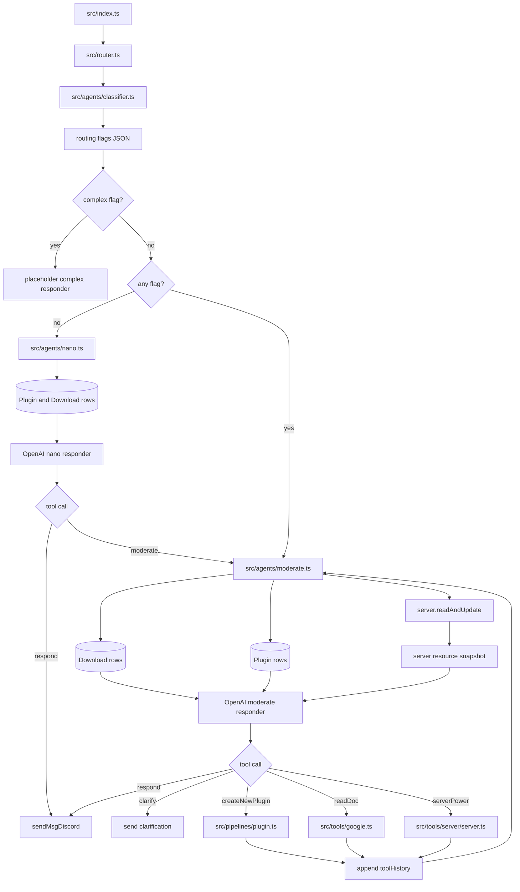

# Agent Routing And Responders

## What This System Does

The routing system decides how much agent capability a Discord request needs. It chooses between a small responder (`nano`), the tool-using responder (`moderate`), and a future complex workflow responder.

The active files are:

- `src/router.ts`
- `src/agents/classifier.ts`
- `src/agents/nano.ts`
- `src/agents/moderate.ts`
- `src/types.ts`
- `src/models.ts`

## How It Works

`src/router.ts` calls `classifier(info)` for every non-clarification request. The classifier returns strict JSON flags:

- `needs_plugin_work`
- `needs_server_action`
- `needs_recent_data`
- `needs_structured_planning`
- `needs_to_browse_web`
- `needs_document_access`
- `needs_multiple_server_actions`
- `needs_iterative_code_execution_or_debugging`
- `needs_large_workflow`

Router behavior:

1. If any complex flag is true, return the placeholder complex response.
2. Else if any flag is true, call `moderate(info, toolHistory)`.
3. Else call `nano(info, toolHistory)`.

`nano` builds a compact resource view from Prisma downloads and plugins. It must call exactly one model tool:

- `respond` sends a plain Discord response with optional files.
- `moderate` escalates to the moderate responder.

`moderate` builds a richer resource view from Prisma downloads, plugins, and current server data. It asks the model to call one tool at a time:

- `respond`
- `createNewPlugin`
- `clarify`
- `readDoc`
- `serverPower`
- OpenAI built-in `web_search`

For tool calls that need another model turn, `moderate` pushes a `ToolResult` into `toolHistory` and recursively calls itself. The next model call sees the same user message plus updated tool history.

## System Map

## Dependencies

- **Why this shape:** Routing keeps cheap plain-text answers on `nano`, sends tool-backed work to `moderate`, and reserves large multi-step work for a future complex responder. This keeps expensive tool context and recursive tool loops out of requests that do not need them.
- **Depends on:** `AgentInfo`, classifier JSON flags, OpenAI tool calling, Prisma downloads/plugins, `server.readAndUpdate()`, Google Docs tooling, plugin creation, server power operations, and Discord response helpers.
- **Depended on by:** The Discord runtime for every non-clarification request, `nano` escalation into `moderate`, tool-history driven follow-up turns, plugin creation, document reads, and server power requests.

## Problems, Limitations, And Notes

- The complex responder does not exist yet. The route returns placeholder text.
- `src/router.ts` checks `needs_code_execution_or_debugging_or_testing`, but `classifier.ts` returns `needs_iterative_code_execution_or_debugging`.
- `moderate()` exposes `web_search`, but its output parser only handles `function_call` items.
- Tool loops are recursive and have no explicit maximum number of turns.
- `moderate()` exposes only `serverPower`; server file tools and command execution are implemented elsewhere but are not model tools yet.
- Existing-plugin editing is rejected by prompt instruction even though internal medium plugin creation uses edit plans.
- `nano` can send files from downloads, but it cannot call any external tools directly.
- Both responders rebuild resource context from the database on every call.
- Model names are centralized in `src/models.ts`, but they reference future or provider-specific model ids that must be valid in the deployed OpenAI account.
