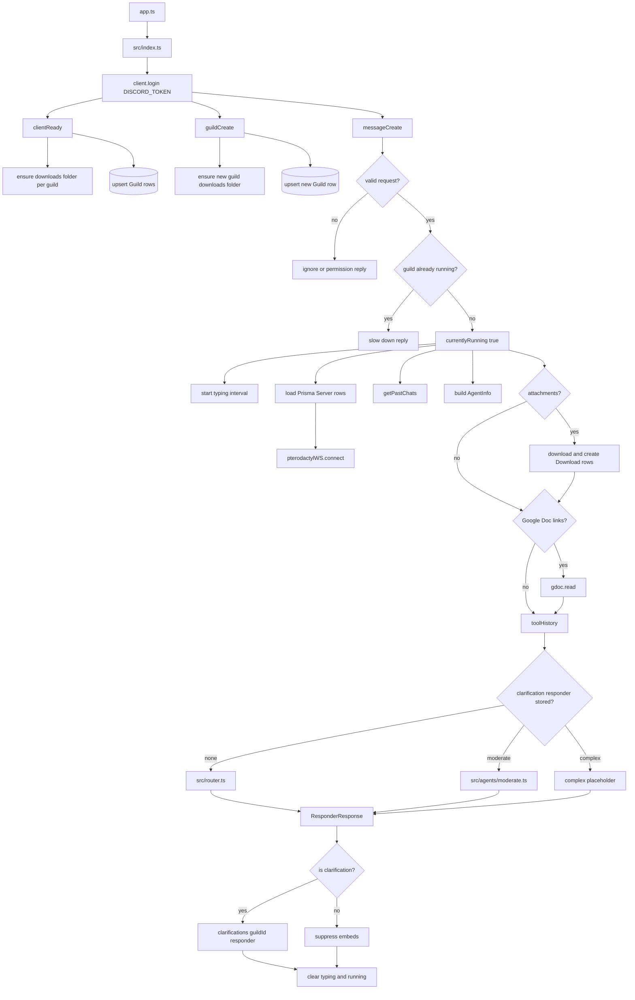

# Discord Runtime

## What This System Does

The Discord runtime is the user-facing entrypoint for AgentSteve. It logs into Discord, registers guild records, accepts administrator mentions, gathers context, prepares resources, routes the request through the agent stack, and sends the final Discord replies.

The implementation is centered in `src/index.ts`. It is started by `app.ts`.

## How It Works

Startup behavior:

1. `app.ts` imports `src/index.ts`.
2. `src/index.ts` creates a Discord client with guild, message, direct-message, message-content, reaction, and poll intents.
3. `client.login(process.env.DISCORD_TOKEN)` starts the bot.
4. On `clientReady`, Steve creates a downloads folder for each guild and upserts each guild into Prisma.
5. On `guildCreate`, Steve creates the new guild's downloads folder and upserts the guild row.

Message behavior:

1. Ignore bot messages, `@everyone`, DMs, messages that do not mention Steve, and non-admin users.
2. Reject concurrent requests for the same guild with `currentlyRunning[guildId]`.
3. Load known guild servers and open Pterodactyl websocket connections.
4. Build `AgentInfo` with guild id, Discord message, and recent chat context from `getPastChats()`.
5. Download attached files into `src/tools/downloads/<guildId>/` and create `Download` rows.
6. If the message contains Google Doc links, pre-run `gdoc.read()`.
7. Route to the previous clarification responder, the main router, or the placeholder complex responder.
8. Suppress embeds on sent messages when possible.
9. Clear typing and concurrency state in `finally`.

Long responses and file attachments are sent through `src/tools/sendMsgDiscord.ts`.

## System Map

## Problems, Limitations, And Notes

- `currentlyRunning` is process-local. It does not coordinate across multiple Node processes.
- `clarifications[guildId]` is process-local and is not cleared after a normal follow-up.
- The complex responder branch replies with placeholder text.
- Startup comments still mention command registration, but no Discord commands are registered.
- Attachment downloads trust Discord attachment URLs and save files by sanitized base name only.
- `ensureDownloadPath()` creates only one directory level and does not use `{ recursive: true }`.
- Google Doc pre-read returns early for auth and permission failures because `gdoc.read()` sends the auth message itself.
- Very large docs are rejected at the Discord runtime before routing. Document summarization is TODO.
- The file imports `architect` and `arch` for temporary testing, but they are unused in the runtime path.
