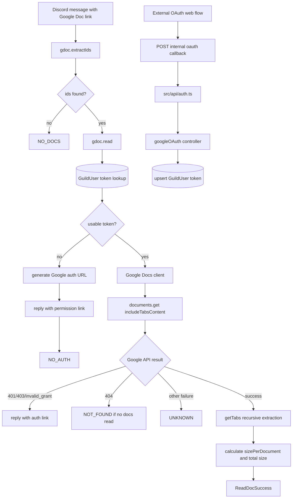

# Google Docs Workflow

## What This System Does

The Google Docs workflow lets Steve read Google Docs linked in Discord messages after the requesting guild user grants OAuth access. It supports pre-reading docs before routing and explicit `readDoc` tool calls from `moderate()`.

The active files are:

- `src/tools/google.ts`
- `src/api/controllers/googleOAuth.ts`
- `src/api/routes.ts`
- `src/api/auth.ts`
- `prisma/schema.prisma` (`GuildUser.token`)

## How It Works

`gdoc.extractIds(content)` scans text for `https://docs.google.com/document/d/` links and returns unique document ids.

`gdoc.read(guildId, content, message, ids?)` then:

1. Uses ids from the message content, or explicit ids from the model tool call.
2. Looks up the requesting user's `GuildUser` row for the current guild.
3. Builds a Google OAuth client from `google-key-file.json`.
4. Generates an auth URL with `documents.readonly` scope and state of `<userId>,<guildId>`.
5. If no stored token is available, replies in Discord with the auth link and returns `NO_AUTH`.
6. Calls `google.docs({ version: "v1" })`.
7. Reads each requested document with `includeTabsContent: true`.
8. Extracts tab text recursively into `DocTabs`.
9. Returns document title, id, link, tab content, per-document size, and total serialized size.

The internal API endpoint `POST /internal/aiagents/steve/oauth/google/callback` stores tokens in `GuildUser` after an external web layer completes Google OAuth and posts the token, guild, and user values.

## System Map

## Dependencies

- **Why this shape:** Google Docs access is user-scoped because document permissions belong to the Discord user, not the guild as a whole. The runtime pre-reads linked docs when possible, while `moderate()` keeps an explicit `readDoc` tool for follow-up requests and model-directed reads.
- **Depends on:** Google OAuth credentials, Google Docs API access, Prisma `GuildUser.token`, Discord message/user identity, the internal OAuth callback route, and `sendMsgDiscord` for authorization prompts.
- **Depended on by:** Discord pre-read handling, the `readDoc` tool in `moderate()`, routing decisions that need document context, and any workflow planner or responder that needs linked document content.

## Problems, Limitations, And Notes

- The internal API route is `/internal/aiagents/steve/oauth/google/callback`, while OAuth clients use `http://localhost:3000/aiagents/steve/oauth/google/callback`. The code comments imply an external web server proxies the public callback.
- `googleOAuth` stores `token` directly on create but `JSON.stringify(token)` on update. `gdoc.read()` currently parses only string tokens, so JSON-object token storage can be treated as unauthenticated.
- `gdoc.read()` uses the Discord message author as the OAuth identity, so doc access is per user per guild.
- Large docs are handled outside and inside the responder path. The runtime rejects totals over about 20,000 serialized characters during pre-read.
- There is a TODO to add document summarization for large documents.
- The tab extraction grabs paragraph text runs. It does not preserve rich formatting, tables, images, comments, or suggestions.
- The `sizePerDocument` values are strings, not numbers.
- `gdoc.extractIds()` is simple string parsing, not a URL parser.
