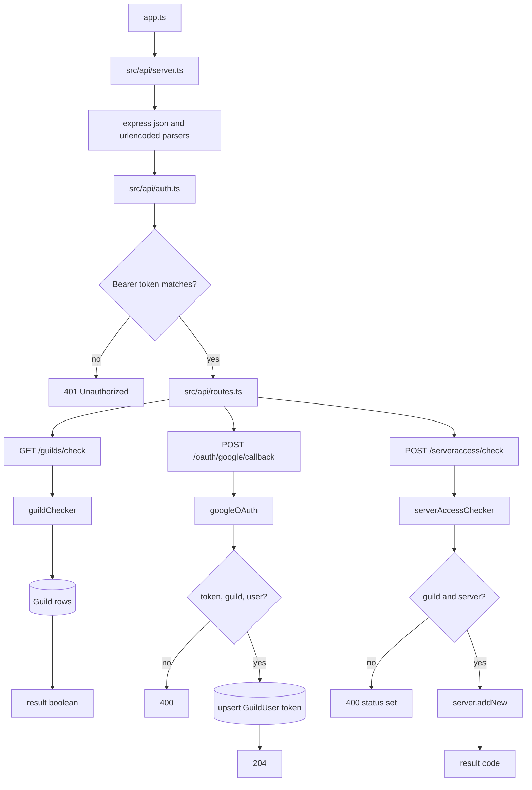

# Internal API

## What This System Does

The internal API is a small Express server for trusted callers that need to coordinate with AgentSteve. It checks guild existence, stores Google OAuth tokens, and validates Pterodactyl server access.

The active files are:

- `src/api/server.ts`
- `src/api/auth.ts`
- `src/api/routes.ts`
- `src/api/controllers/*`

`app.ts` starts this API by importing `src/api/server.ts`.

## How It Works

`src/api/server.ts` creates one Express app, installs JSON and URL-encoded body parsers, applies auth middleware to all routes, mounts the router at `/internal/aiagents/steve`, installs a catch-all 404 handler, and listens on `process.env.PORT`.

Every request must include:

```text
Authorization: Bearer <STEVE_INTERNAL_KEY>
```

Routes:

- `GET /internal/aiagents/steve/guilds/check?guild=<guildId>`
  - Returns `{ result: true }` if the guild exists in Prisma.
- `POST /internal/aiagents/steve/oauth/google/callback`
  - Requires `token`, `guild`, and `user` in the request body.
  - Upserts `GuildUser.token`.
- `POST /internal/aiagents/steve/serveraccess/check`
  - Requires `guild` and `server` in the request body.
  - Calls `server.addNew(guild, server)`.
  - Returns the server-access result code.

## System Map



## Dependencies

- **Why this shape:** The API is intentionally small and bearer-token protected because it exists for trusted setup callbacks rather than public user traffic. It delegates domain work to controllers and tools so Discord-facing code and external setup flows share the same Prisma records.
- **Depends on:** Express, `STEVE_INTERNAL_KEY`, `PORT` and `HOSTNAME`, Prisma guild and user/server models, the Google OAuth controller, and `server.addNew()`.
- **Depended on by:** External Google OAuth callback infrastructure, external server-access setup flows, guild existence checks, `gdoc.read()` token lookup, and the server management onboarding path.

## Problems, Limitations, And Notes

- The API is intended for internal callers only. There is no user-session auth, only a shared bearer key.
- `HOSTNAME` and `PORT` come from environment variables, but there is no explicit default.
- The catch-all 404 handler sets status 404 but does not send a body.
- `serverAccessChecker` returns `res.status(400)` without sending a response body when required fields are missing.
- The Google OAuth controller constructs an OAuth client that is not used inside the handler.
- Google OAuth token storage is inconsistent between create and update paths, which can affect `gdoc.read()`.
- Routes are mounted under `/internal/aiagents/steve`, while Google OAuth redirect URLs elsewhere refer to `/aiagents/steve/oauth/google/callback`, implying an external proxy layer.
