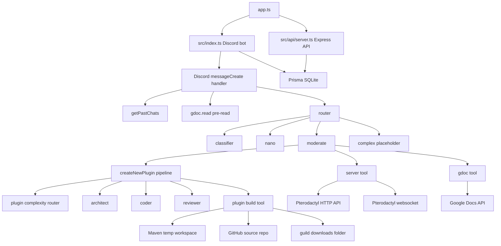

# AgentSteve Architecture Overview

`AgentSteve` is a TypeScript Node.js application with two live entrypoints:

- A Discord bot runtime in `src/index.ts`
- An internal Express API in `src/api/server.ts`

`app.ts` starts both by importing them in the same process.

## System map

## Main runtime layers

### 1. Entry and orchestration

- `app.ts` loads the Discord bot and the internal API server.
- `src/index.ts` owns Discord lifecycle, message gating, attachment ingestion, doc pre-reading, clarification state, and final reply handling.
- `src/router.ts` decides whether to use `nano`, `moderate`, or the placeholder `complex` responder.

### 2. Agents

- `src/agents/classifier.ts` sets routing flags for the current message.
- `src/agents/nano.ts` is a lightweight responder that either answers directly or escalates to `moderate`.
- `src/agents/moderate.ts` is the main tool-using responder.
- `src/agents/plugins/*` contains the plugin-specific specialists:
  - `router.ts` scores plugin complexity
  - `architect.ts` breaks medium plugins into tasks
  - `coder.ts` generates plugin manifests or edit plans
  - `reviewer.ts` summarizes a finished plugin

### 3. Pipelines and tools

- `src/pipelines/plugin.ts` is the most complete multi-step workflow in the repo.
- `src/tools/google.ts` reads Google Docs after OAuth.
- `src/tools/server/*` manages Pterodactyl server access, power state, files, and websockets.
- `src/tools/plugin.ts` turns an in-memory plugin manifest into a built JAR, stores it in downloads, and mirrors the source to GitHub.
- `src/tools/sendMsgDiscord.ts` splits long replies and attaches downloaded files.

### 4. Persistence and local state

- Prisma uses SQLite through `lib/prisma.ts`.
- Permanent-ish state lives in Prisma models.
- Per-process transient state lives in memory:
  - `clarifications[guildId]`
  - `currentlyRunning[guildId]`
  - `pterodactylWS.sockets`
  - `pterodactylWS.pendingCommands`
- Local filesystem state lives under:
  - `src/tools/downloads/<guildId>/` for user uploads, server downloads, and built plugin JARs
  - `src/tools/pluginBuilder/<guildId>/<builderId>/` for temporary Maven builds
  - `dev-logs/` for JSON log files

## Discord request lifecycle

When an admin mentions Steve in a guild:

1. `src/index.ts` rejects bot messages, `@everyone`, DMs, non-admins, and concurrent guild requests.
2. It loads guild servers from Prisma and opens websocket connections for them.
3. It builds `AgentInfo` with:
   - `guildId`
   - the current Discord `message`
   - `pastChats` from `getPastChats()`
4. It downloads attached files into the guild downloads folder and records them in Prisma.
5. If the message contains Google Doc URLs, it pre-runs `gdoc.read()`.
6. It routes through:
   - a clarification shortcut, if one is active for the guild
   - otherwise `src/router.ts`
7. It sends the resulting Discord message(s) and suppresses embeds when possible.

## Internal API surface

The Express server is small and intended for trusted internal callers.

- `GET /internal/aiagents/steve/guilds/check`
  - Returns whether a guild exists in the DB.
- `POST /internal/aiagents/steve/oauth/google/callback`
  - Stores Google OAuth tokens for a user/guild pair.
- `POST /internal/aiagents/steve/serveraccess/check`
  - Attempts to grant Steve access to a remote Pterodactyl server.

All routes are guarded by `Authorization: Bearer <STEVE_INTERNAL_KEY>` through `src/api/auth.ts`.

## Data model

`prisma/schema.prisma` defines the persistent objects:

- `Guild`: top-level ownership bucket.
- `Download`: files Steve can later send back or upload elsewhere.
- `Plugin`: metadata for generated plugins.
- `Server`: remote server metadata plus cached `data` JSON and current `status`.
- `ConsoleLine`: websocket-captured console history for a server.
- `GuildUser`: per-user, per-guild OAuth token storage.

## External dependencies

- Discord: message ingress and response transport.
- OpenAI Responses API: all agent reasoning.
- Google Docs API: reading shared documents.
- Pterodactyl client API and websocket: server control and console data.
- GitHub REST API: private source repo storage for generated plugins.
- Maven: local plugin compilation.
- SQLite via Prisma: application state.

## Important implementation realities

These are visible in the current code.

- The `complex` responder is referenced but not implemented. Both `src/index.ts` and `src/router.ts` return placeholder text for it.
- `src/router.ts` checks `routingFlags.needs_code_execution_or_debugging_or_testing`, but the classifier returns `needs_iterative_code_execution_or_debugging`. One intended complex-routing flag is currently disconnected.
- `clarifications[guildId]` is set when a responder asks a clarification question, but it is never cleared after a normal follow-up.
- `moderate()` advertises the built-in `web_search` tool, but its code only handles `function_call` outputs.
- Server file tools exist in code, but `moderate()` currently exposes only `serverPower` to the model.
- Editing existing plugins is explicitly not implemented at the user-facing `moderate()` layer, even though the internal plugin pipeline already has an edit-plan mechanism for medium plugin creation.

## Suggested reading order in code

For new maintainers, the clearest path is:

1. `app.ts`
2. `src/index.ts`
3. `src/router.ts`
4. `src/agents/nano.ts`
5. `src/agents/moderate.ts`
6. `src/pipelines/plugin.ts`
7. `src/tools/plugin.ts`
8. `src/tools/server/*`
9. `src/tools/google.ts`
