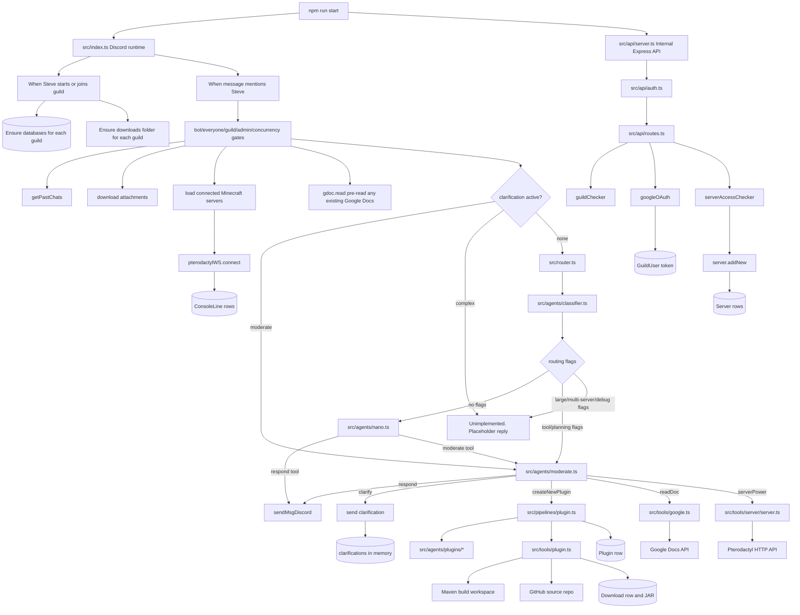

# AgentSteve Architecture Overview

## Goal
The goal of `AgentSteve` is to create an AI assistant for Minecraft server owners that can:
- Interact with remote Minecraft servers (files, console commands, power actions, etc)
- Create and edit large-scale Minecraft plugins
- Read documents, edit documents, browse the web, read certain file contents

Users should be able to:
- Interact with `AgentSteve` through Discord (though we may also implement a UI on a website).
- Revert changes `AgentSteve` makes to their Minecraft server through a simple UI.

## About
User-facing:
On the surface `AgentSteve` is:
- An AI assitant built to help Minecraft server owners.
- One agent that the user talks to.

Technical:
On the technical side `AgentSteve` is:
- A TypeScript Node.js service that runs a Discord bot and a small internal Express API in the same process. 
- A complex AI system comprised of many interacting sub-agents.
`AgentSteve` can better be understood as a full-scale app that uses LLMs where reasoning or text generation is needed rather than a simple chat bot.

The active production path today is:

1. A Discord mention enters `src/index.ts`.
2. `src/agents/classifier.ts` evaluates different flags about the request and `src/router.ts` routes the request accordingly.
3. The request is either forwarded to `nano`, `moderate`, or the unimplemented `complex` path.
4. `nano` can only respond, `moderate` can iteratively call tools and then respond, and `complex` is unimplemented.
5. Results are persisted through Prisma and sent back to Discord.

## Documentation Map

- [discord-runtime.md](discord-runtime.md) - Discord lifecycle, message gating, attachments, Google Doc pre-read, clarification state, and replies.
- [agent-routing.md](agent-routing.md) - Classifier, router, nano responder, moderate responder, tool loop, and routing limitations.
- [plugin.md](plugin.md) - New-plugin generation pipeline, specialist agents, Maven build loop, GitHub source persistence, and plugin records.
- [google-docs.md](google-docs.md) - Google OAuth token storage and Google Docs reading.
- [server-management.md](server-management.md) - Pterodactyl server access checks, power operations, file tools, and websocket console capture.
- [internal-api.md](internal-api.md) - Internal Express API, auth middleware, and controllers.
- [persistence-and-files.md](persistence-and-files.md) - Prisma models, local download/build/log folders, and local state.
- [workflow-orchestrator.md](workflow-orchestrator.md) - In-progress workflow planner in `src/agents/workflow.ts`.

## How It Works

`app.ts` is outdated. `npm run start` is now used to simultaneously start the bot and the API server.

The Discord runtime owns the user-facing request lifecycle. It creates guild records on startup and guild join, accepts only administrator mentions, gathers recent chat context, stores attachments, pre-reads Google Docs when possible, opens websocket connections for known servers, and then calls the router.

The router uses the classifier's JSON flags to pick a responder:

- `nano` for plain-text answers that do not require tools.
- `moderate` for tool-backed work and higher-capability reasoning.
- `complex` for large or multi-step work, but this responder is currently only a placeholder.

The moderate responder exposes a small tool set to the model:

- `respond`
- `createNewPlugin`
- `clarify`
- `readDoc`
- `serverPower`
- built-in `web_search`

The plugin pipeline is the deepest workflow. It routes complexity, optionally designs tasks, generates or edits an in-memory project manifest, builds with Maven, attempts bounded build repair, stores the JAR in downloads, persists source to GitHub, reviews the project, and writes a `Plugin` row.

The internal API is intended for trusted services only. Every route is guarded by `Authorization: Bearer <STEVE_INTERNAL_KEY>`.

## System Map

## Major Runtime Layers

### Entrypoints

- `npm run start` starts the bot and API by importing modules.
- `src/index.ts` owns Discord runtime behavior.
- `src/api/server.ts` owns the internal Express server.

### Agents

- `src/agents/classifier.ts` returns routing flags.
- `src/agents/nano.ts` answers simple requests or escalates to `moderate`.
- `src/agents/moderate.ts` orchestrates the currently exposed tools.
- `src/agents/workflow.ts` contains an in-progress workflow planner that is not wired into the current router.
- `src/agents/plugins/*` contains plugin-specialist agents for complexity, planning, coding, and review.

### Tools and Pipelines

- `src/pipelines/plugin.ts` runs new-plugin creation end to end.
- `src/tools/plugin.ts` builds plugin manifests into JARs and persists source to GitHub.
- `src/tools/google.ts` reads Google Docs through stored OAuth tokens.
- `src/tools/server/*` manages Pterodactyl access, power, files, and console websockets.
- `src/tools/sendMsgDiscord.ts` sends split Discord replies and file attachments.

### Persistence and Local State

- Prisma uses SQLite through `lib/prisma.ts`.
- Durable domain state lives in `Guild`, `Download`, `Plugin`, `Server`, `ConsoleLine`, and `GuildUser`.
- Transient state lives in process memory:
  - `clarifications[guildId]`
  - `currentlyRunning[guildId]`
  - `pterodactylWS.sockets`
  - `pterodactylWS.pendingCommands`
- Local filesystem state lives under:
  - `src/tools/downloads/<guildId>/`
  - `src/tools/pluginBuilder/<guildId>/<builderId>/`
  - `dev-logs/`

## Dependencies

- **Why this shape:** The service is built as one Node process so the Discord bot, internal setup API, in-memory clarification/concurrency state, and shared Prisma client can coordinate without a separate job system. Tool-heavy work is isolated into agents, tools, and pipelines so the router can keep the user-facing request path narrow.
- **Depends on:** Discord, OpenAI models and tool calling, Express, Prisma/SQLite, local filesystem storage, Google Docs/OAuth, Pterodactyl, GitHub, Maven, Java 17, and environment secrets.
- **Depended on by:** Discord users, trusted internal setup callers, every subsystem documented here, and operational workflows that rely on shared guild, download, plugin, server, OAuth, and console state.

## Problems, Limitations, And Notes

- The `clarify` system where the `src/agents/moderate.ts` agent can choose to use the clarify tool to clarify something rather than directly respond feels messy, inefficient, and unhelpful. Could there be a better way to do this?
- The `complex` responder is referenced by `src/index.ts`, `src/router.ts`, and `src/types.ts`, but it currently returns placeholder text.
- `src/router.ts` checks `routingFlags.needs_code_execution_or_debugging_or_testing`, while the classifier schema returns `needs_iterative_code_execution_or_debugging`. That intended complex-routing flag is disconnected.
- `clarifications[guildId]` is set after a clarification, but it is not cleared after a normal follow-up.
- `moderate()` advertises OpenAI `web_search`, but the code only handles function-call outputs. If the model returns a non-function web search result without a following function call, the responder falls into the "GPT did not call a tool" error path.
- Server file tools exist in `src/tools/server/files.ts`, but `moderate()` currently exposes only `serverPower`.
- User-facing existing-plugin editing is explicitly not implemented, even though the plugin pipeline has an internal edit-plan mechanism for medium new-plugin tasks.
- Google Docs larger than about 20,000 serialized characters are rejected during pre-read; document summarization is marked TODO.
- Memory summaries and Discord slash commands are marked TODO.
- Pterodactyl websocket console command resolution depends on sentinel command output and recent console history, so it is sensitive to server output formatting and timing.
