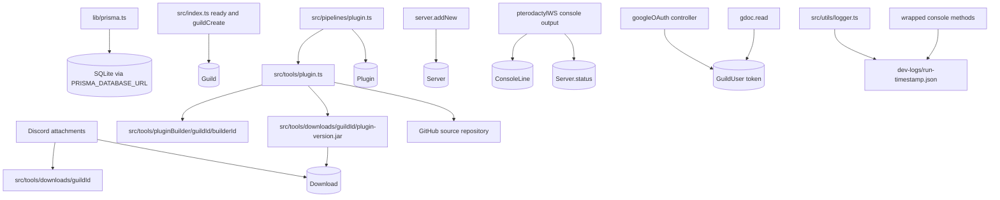

# Persistence And File Storage

## What This System Does

AgentSteve uses SQLite through Prisma for durable application state and a few local folders for files generated or collected during workflows. The database tracks guilds, downloads, generated plugins, remote servers, console history, and per-user OAuth tokens.

The active files are:

- `prisma/schema.prisma`
- `lib/prisma.ts`
- `src/tools/downloads/<guildId>/`
- `src/tools/pluginBuilder/<guildId>/<builderId>/`
- `dev-logs/`
- `src/utils/logger.ts`

## How It Works

`lib/prisma.ts` creates a Prisma client using `@prisma/adapter-better-sqlite3` and `process.env.PRISMA_DATABASE_URL`.

Database models:

- `Guild`
  - Top-level Discord guild record.
  - Owns downloads, plugins, servers, and guild users.
- `Download`
  - A file Steve can send back to Discord or upload to a server.
  - Stores file name and description.
- `Plugin`
  - Metadata for a generated plugin.
  - Stores plugin name, version, description, and JAR file name.
- `Server`
  - Remote Pterodactyl server record.
  - Stores cached JSON metadata, type, and current status.
- `ConsoleLine`
  - Timestamped console output captured from websockets.
  - Indexed by server id and created time.
- `GuildUser`
  - Per-user, per-guild storage for Google OAuth tokens.
  - Unique by `userId` and `guildId`.

Local file storage:

- `src/tools/downloads/<guildId>/`
  - User-uploaded Discord attachments.
  - Downloaded server files.
  - Built plugin JARs.
- `src/tools/pluginBuilder/<guildId>/<builderId>/`
  - Temporary Maven project workspace for plugin builds.
  - Deleted after each build attempt.
- `dev-logs/run-<timestamp>.json`
  - Append-only JSON logs from the custom logger and wrapped console methods.

GitHub storage:

- `src/utils/github.ts` creates private repos and writes generated plugin source files.
- Repositories are named `<guildId>-<pluginName>` under the `agent-steve-official` account.

## System Map

## Problems, Limitations, And Notes

- The SQLite database file in this workspace is `dev.db`, while the runtime uses `PRISMA_DATABASE_URL` from the environment.
- Local files are not content-addressed. Name collision handling is implemented separately in attachment and server download paths.
- The downloads folder is guild-scoped but not user-scoped.
- `Download.file` stores only the file name, not a full path or hash.
- Temporary plugin builder directories are cleaned in `finally`, but interrupted processes can leave stale folders.
- Dev logs can contain full OpenAI payloads when `logResponse` and `logAmount` allow it.
- `src/devVariables.ts` currently has verbose logging enabled with `logAmount = 2` and `logResponse = true`.
- `GuildUser.token` is a Prisma `Json?` field, but Google token read/write code does not consistently treat it as JSON.
- GitHub source persistence is external durable state but is not represented as its own Prisma model.
