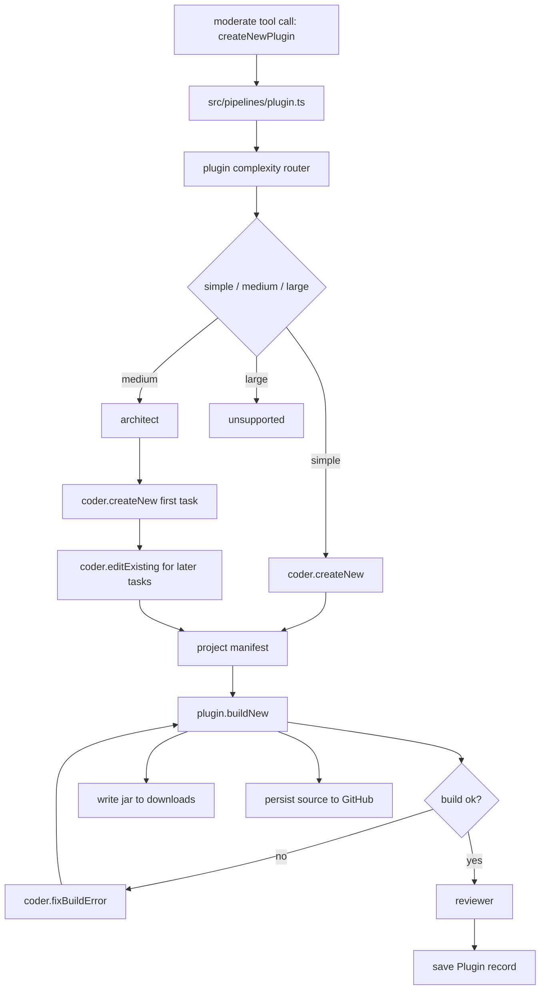

# Plugin Subsystem Architecture

The plugin subsystem is the most developed multi-agent workflow in `AgentSteve`. Its job is to turn a Discord request for a Paper 1.20.1 plugin into:

- a built `.jar` in the guild downloads folder
- a `Plugin` database record
- a private GitHub source repository
- a short summary returned to the user

## Component map

## Core request and state shapes

The plugin pipeline is intentionally type-heavy. The important shapes are in `src/agents/plugins/types.ts`.

### `PluginCreationRequest`

This is the user-facing request passed into the pipeline:

- `pluginName`
- `assistantMessage.intent`
- `assistantMessage.summary`
- `assistantMessage.requirements[]`

`moderate()` builds this object before calling `createNewPlugin`.

### `PluginProjectManifest`

This is the in-memory representation of a complete plugin project:

- `description`
- `javaFiles[]`
- `resourceFiles[]`
- `dependencies[]`
- `repositories[]`

This object is what the build tool consumes.

### `PluginEditPlan`

Medium-complexity follow-up tasks do not rewrite the whole project. They return a declarative patch plan:

- `deletions[]`
- `insertions[]`
- `newJavaFiles[]`
- `newResourceFiles[]`
- full replacement `dependencies[]`
- full replacement `repositories[]`

`src/pipelines/plugin.ts` applies the patch plan back onto the current manifest.

## Pipeline stages

### 1. Duplicate check

`createNewPlugin()` first calls `plugin.exists(pluginName, guildId)`.

That checks:

- Prisma `Plugin` rows
- GitHub repos scoped to `agent-steve-official/<guildId>-<pluginName>`

If either already exists, the pipeline stops immediately.

### 2. Complexity routing

`src/agents/plugins/router.ts` scores the request from 1 to 10 and maps it to a tier:

- `1-4` -> `simple`
- `5-7` -> `medium`
- `8-10` -> `large`

The returned `tier` is recomputed from the score, even if the model supplied a mismatched tier.

### 3. Project design

#### Simple

- Skip the architect entirely.
- Call `coder.createNew()`.
- Expect a full `PluginProjectManifest`.

#### Medium

- Call `architect()` to get sequential `PluginTask[]`.
- Use the first task when calling `coder.createNew()`.
- For each remaining task, call `coder.editExisting()` against the current manifest.
- Apply each returned `PluginEditPlan` locally inside the pipeline.

#### Large

- Immediately fail with `LARGE_UNSUPPORTED`.

### 4. Build and repair loop

`runJarBuilderWorkflow()` handles compilation and bounded repair:

- Attempt to build the current manifest once.
- If the build fails with `BUILD_FAILED`, call `coder.fixBuildError()`.
- Retry build.
- Maximum repair attempts: `2`

This means the workflow allows:

- 1 initial build
- up to 2 fix-and-rebuild cycles

If any other build error happens, or retries are exhausted, the pipeline returns `BUILD_FAILED`.

### 5. Review and persistence

After a successful build:

1. `reviewer()` summarizes the finished project and artifact.
2. `savePluginRecord()` writes or updates the Prisma `Plugin` row.
3. The user-facing success payload includes:
   - `pluginName`
   - `version`
   - `file`
   - `summary`
   - `complexityScore`
   - `complexityTier`

If the reviewer fails, the pipeline still keeps the working build and falls back to:

- `project.description`, if present
- otherwise `request.assistantMessage.summary`

## Build tool behavior

`src/tools/plugin.ts` owns the build step.

It:

- validates that at least one Java file exists
- requires `plugin.yml`
- requires `plugin.yml` to contain `main: com.walrusmc.<pluginNameLower>.<PluginName>`
- merges default and model-supplied repositories/dependencies
- renders `pom.xml`
- writes the project into a temporary builder directory
- runs `mvn -f pom.xml -B clean package`
- moves the built JAR into `src/tools/downloads/<guildId>/`
- creates or updates the matching `Download` row
- writes all source files plus `pom.xml` to GitHub

## Why the patch application is local

The edit coder does not directly emit whole-file rewrites for medium tasks. The pipeline applies its patch plan itself. That gives the pipeline control over:

- duplicate file detection
- path normalization
- deterministic task ordering
- error handling when an edit plan cannot be applied

This is one of the cleaner design choices in the current codebase: the model proposes edits, and deterministic TypeScript code mutates the project state.

## What each plugin specialist can see

All plugin specialists share the same normalized `user` payload:

- `pastChats`
- `currentUserMessage`

They also all receive an `assistant` payload that starts with:

- `pluginRequest`

Then each specialist gets its own extra context:

- complexity router: just `pluginRequest`
- architect: just `pluginRequest`
- coder create: `pluginRequest` plus workflow task context
- coder edit: `pluginRequest` plus workflow context plus line-numbered current project
- coder fix: `pluginRequest` plus full current project plus build error text
- reviewer: `pluginRequest` plus final project plus built artifact

## Current limitations

- The whole subsystem only supports creating new plugins from the user-facing `moderate()` agent.
- Complexity tier `large` is deliberately blocked.
- Build repair is limited to two fix attempts.
- GitHub persistence failure causes the overall build result to fail even if the JAR was created successfully.
- The pipeline assumes Maven is available locally and that GitHub credentials are configured.
