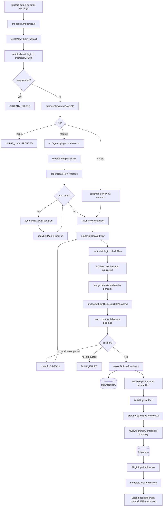

# Plugin Creation System

## What This System Does

The plugin system turns a Discord request for a new Paper 1.20.1 plugin into:

- A compiled `.jar` in `src/tools/downloads/<guildId>/`.
- A `Download` database row for that JAR.
- A `Plugin` database row with version, file, and summary metadata.
- A private GitHub source repository named `<guildId>-<pluginName>`.
- A final user-facing response from `moderate()`.

The public entrypoint is the `createNewPlugin` tool exposed by `src/agents/moderate.ts`. The actual workflow lives in `src/pipelines/plugin.ts`.

## How It Works

`moderate()` first asks the model to call `createNewPlugin` with a structured `PluginCreationRequest`. That request includes a Java-class-safe plugin name, a short intent, a behavior summary, and concrete requirements.

`createNewPlugin()` then runs these stages:

1. Reject duplicates by checking Prisma `Plugin` rows and GitHub repos through `plugin.exists()`.
2. Ask the plugin complexity router for a 1-10 score and map it to `simple`, `medium`, or `large`.
3. Generate a project manifest:
   - `simple`: call `coder.createNew()` once.
   - `medium`: call `architect()`, create an initial project from the first task, then apply edit plans for remaining tasks.
   - `large`: stop with `LARGE_UNSUPPORTED`.
4. Build the manifest into a JAR with `plugin.buildNew()`.
5. If Maven fails, call `coder.fixBuildError()` and retry up to two times.
6. Review the successful project with `reviewer()`.
7. Save or update the `Plugin` row.
8. Return the success payload to `moderate()`, which calls itself again with tool history and sends the final answer.

The central data shape is `PluginProjectManifest` from `src/agents/plugins/types.ts`. It contains the complete in-memory project:

- `description`
- `javaFiles[]`
- `resourceFiles[]`
- `dependencies[]`
- `repositories[]`

For medium plugins, later tasks return `PluginEditPlan` instead of a full project. The pipeline applies those changes deterministically with local TypeScript code.

## System Map

## Specialist Agents

`src/agents/plugins/router.ts`

- Classifies plugin complexity from 1 to 10.
- Recomputes the tier from the score instead of trusting the model's tier.
- Uses `models.general.high.slow`.

`src/agents/plugins/architect.ts`

- Runs only for medium plugins.
- Produces ordered tasks with optional Maven dependencies and repositories.
- Can mark a request impossible.

`src/agents/plugins/coder.ts`

- `createNew()` returns a complete `PluginProjectManifest`.
- `editExisting()` returns a targeted `PluginEditPlan` against line-numbered files.
- `fixBuildError()` returns a corrected full manifest after a build failure.
- Uses coder models from `models.coder.high.slow`.

`src/agents/plugins/reviewer.ts`

- Runs only after a successful build.
- Summarizes user-facing behavior, commands, permissions, and notes.
- Failure does not discard the built JAR. The pipeline falls back to the project description or original request summary.

## Build Tool Behavior

`src/tools/plugin.ts` owns compilation and artifact persistence.

It validates:

- At least one Java file exists.
- `plugin.yml` exists.
- `plugin.yml` contains `main: com.walrusmc.<pluginNameLower>.<PluginName>`.
- Project file paths are relative and cannot escape the build workspace.
- Duplicate project file paths are rejected.

It then:

- Merges model dependencies and repositories with default Paper and Adventure dependencies.
- Renders `pom.xml`.
- Writes files into a temporary Maven workspace.
- Runs `mvn -f pom.xml -B clean package`.
- Moves the built JAR into the guild downloads folder.
- Creates or updates the matching `Download` row.
- Creates a private GitHub repo and writes all source files plus `pom.xml`.
- Removes the temporary builder workspace in `finally`.

## Problems, Limitations, And Notes

- Only new plugin creation is exposed to users. Editing an existing plugin is not exposed by `moderate()`.
- `large` plugin requests are deliberately rejected.
- Build repair is capped at two fix attempts after the initial build.
- GitHub source persistence failure makes `plugin.buildNew()` fail even if Maven produced a valid JAR and the JAR was moved to downloads.
- The pipeline assumes Maven is installed and available as `mvn`.
- The generated plugin must target Paper 1.20.1 and Java 17.
- The GitHub helper is hard-coded around the `agent-steve-official` account for repo file operations.
- `plugin.exists()` falls back to DB-only duplicate checks if GitHub repo listing fails.
- Medium task patching is deterministic, but line-based insertions and deletions still rely on the model choosing correct line numbers.
- `todos.txt` notes desired future work for default plugins and cleaner generated plugin folder structures.
