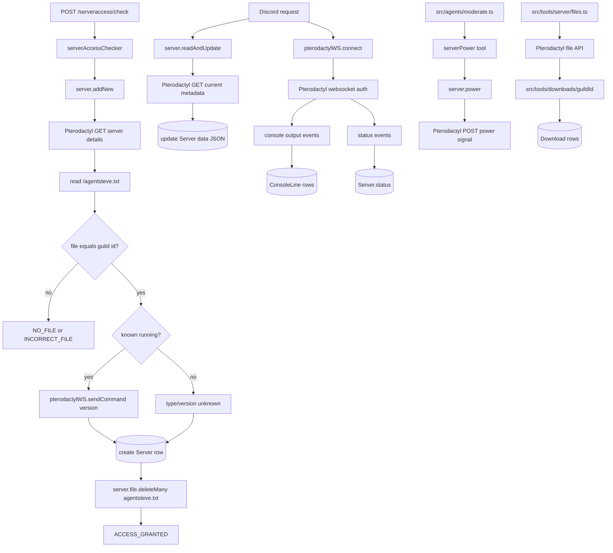

# Server Management System

## What This System Does

The server management system connects AgentSteve to remote Minecraft servers through the Pterodactyl client API. It can validate access to servers, cache server metadata, track power state, run power operations, manage files, and capture console output through websockets.

The active files are:

- `src/tools/server/server.ts`
- `src/tools/server/files.ts`
- `src/tools/server/websocket.ts`
- `src/api/controllers/serverAccess.ts`
- `prisma/schema.prisma` (`Server`, `ConsoleLine`)

## How It Works

Server access is established through `server.addNew(guildId, serverId)`, normally called by the internal API.

Access flow:

1. Fetch server details from the Pterodactyl client API.
2. Reject missing, forbidden, or invalid-key responses.
3. Read `/agentsteve.txt` from the remote server.
4. Require the file contents to exactly match the Discord guild id.
5. If the server is running, try `pterodactylWS.sendCommand(serverId, "version")` to discover server type and version.
6. Create a Prisma `Server` row with cached metadata.
7. Delete `agentsteve.txt` from the remote server.

Request-time server refresh happens in `server.readAndUpdate(guildId)`. It reloads current Pterodactyl metadata for every known guild server, updates cached JSON, and refreshes type/version if the server is running.

Power operations use `server.power(serverId, signal)` and call `/servers/<serverId>/power` with one of `start`, `stop`, `restart`, or `kill`.

File operations exist in `src/tools/server/files.ts`:

- `deleteMany`
- `readMany`
- `read`
- `write`
- `upload`
- `download`

Websocket behavior lives in `src/tools/server/websocket.ts`. It connects to Pterodactyl's websocket endpoint, authenticates with a token, stores normal console output in `ConsoleLine`, updates server status events, and resolves command results by sending a command followed by a `STEVE:<key>:COMMAND` sentinel.

## System Map

## Dependencies

- **Why this shape:** Pterodactyl remains the source of truth for server state while Prisma keeps enough cached metadata for routing, resource summaries, and status updates. Server ownership is proven with a temporary file on the remote server because the bot only knows a Discord guild id during setup.
- **Depends on:** The Pterodactyl HTTP and websocket APIs, a valid Pterodactyl client key, Prisma `Server` and `ConsoleLine` models, guild-scoped download storage, and the shared Discord guild id.
- **Depended on by:** The internal server-access API, Discord startup/request preparation, `moderate()` server power tooling, the in-progress workflow planner, and server file transfer paths that create or consume `Download` rows.

## Problems, Limitations, And Notes

- `moderate()` currently exposes only `serverPower`; file operations and console commands are implemented but not exposed as model tools.
- `todos.txt` notes that Steve should enforce only one guild per server, but `Server.id` is globally unique already while some code still deletes by compound-looking `{ guildId, id }` shapes.
- Websocket state is process-local. A restart loses open sockets and pending commands.
- Command resolution depends on a sentinel line and recent console history. It can time out after 5 seconds.
- The websocket `switch` handles `token expiring` and `jwt error` without a `break`, so it can fall through to status handling.
- `pendingCommands` uses `Map<Number, ...>` instead of `Map<number, ...>`.
- `server.addNew()` tries to determine type/version only when existing cached status says `running`; a new server without a status row usually records type/version as unknown until later refresh.
- Downloaded remote files are copied into guild downloads and create `Download` rows.
- File uploads read from guild downloads only.
- All Pterodactyl calls are hard-coded to `https://panel.wepwawet.net`.
