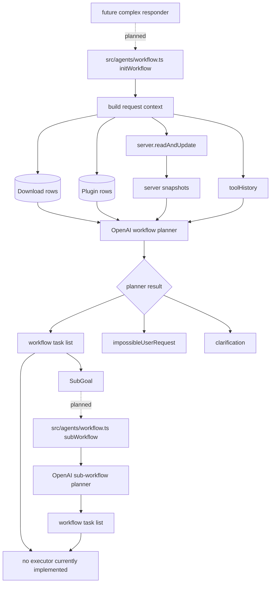

# Workflow Orchestrator

## What This System Does

The workflow orchestrator is an in-progress planning agent intended to create ordered task lists for larger requests. It is not currently wired into `src/router.ts` or `src/index.ts` as an executable responder.

The implementation is in `src/agents/workflow.ts`.

## How It Works

There are two exported functions:

- `initWorkflow(info, toolHistory)`
  - Builds a workflow for the original user request.
  - Can return workflow tasks, an impossible-request message, or a clarification message.
- `subWorkflow(info, toolHistory, goal)`
  - Builds a workflow for a narrower goal inside a larger workflow.
  - Can return workflow tasks or an impossible-goal message.

Both functions gather similar context to `moderate()`:

- Recent chats and current user message.
- Downloads from Prisma.
- Plugins from Prisma.
- Server snapshots from `server.readAndUpdate(guildId)`.
- Previous tool history.

They define possible task schemas for:

- `serverPower`
- `createNewPlugin`
- `editPlugin`
- `readDoc`

The model returns strict JSON through a `text.format` schema rather than tool calls. There is no executor in this file that actually runs the returned workflow tasks.

## System Map

## Problems, Limitations, And Notes

- This system is not connected to the active router. Requests that should go complex receive placeholder text today.
- There is no workflow executor. The functions return task plans only.
- The task schemas include `editPlugin`, but user-facing plugin editing is not implemented.
- The `createNewPlugin` task schema differs from the active `moderate()` tool schema. It uses `description` and `userRequested` instead of `assistantMessage`.
- Both exported functions duplicate a large amount of context-building logic.
- Some prompt text has mojibake characters in "user's".
- Workflow planning uses `models.general.low.fast`, which may be too small for complex planning.
- The planner does not include every implemented server file operation.
- Because no executor exists, error handling, task result accumulation, retries, and final response generation still need design.
